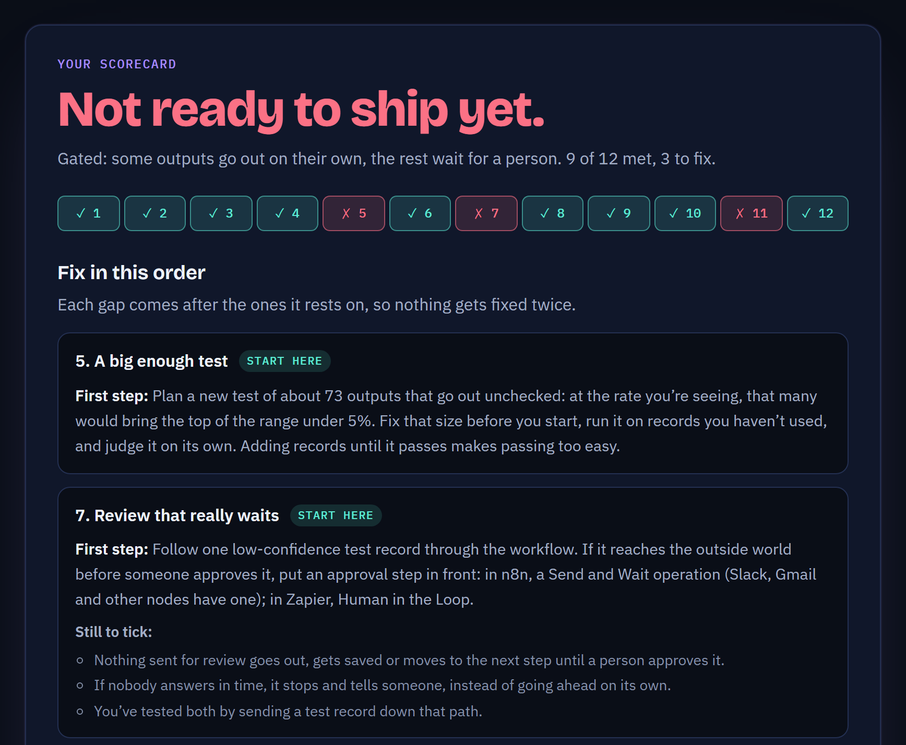

# Ready to ship?

[](https://github.com/DHuberPortfolio/ready-to-ship/actions/workflows/test.yml)

A checklist for anyone about to put an AI workflow into real use. Twelve yes-or-no questions about
the mistakes nobody would see, such as *"Do you know how many of the outputs nobody checked were
wrong?"* and *"When something is sent to a person for review, does it actually wait for their
approval?"* Under each question is a plain-words line saying what it means, then its bar: one to
three things that have to be true, each with its own tick. The scorecard at the end lists every gap
in the order to fix it, gives a first step for each, and says what you could run in the meantime.

**Try it: https://dhuberportfolio.github.io/ready-to-ship/**. It runs in your browser, and nothing
you type is sent anywhere. Prefer paper? [CHECKLIST.md](CHECKLIST.md) has every question and its bar.



## The twelve questions

<!-- generated:questions -->
| # | | The question |
|---|---|---|
| 1 | **A limit, set by the owner** | Has someone who owns the outcome decided how many mistakes are acceptable? |
| 2 | **An answer key** | Do you have an answer key? |
| 3 | **The silent error rate** | Do you know how many of the outputs nobody checked were wrong? |
| 4 | **Tested on records it hasn’t seen** | Did you measure that rate on records you didn’t use while adjusting the workflow? |
| 5 | **A big enough test** | Is your test big enough to show the error rate is under your limit? |
| 6 | **A hard stop on the worst case** | Is the worst thing it could get wrong blocked by a hard rule, not left to judgment? |
| 7 | **Review that really waits** | When something is sent to a person for review, does it actually wait for their approval? |
| 8 | **Reviewers who catch mistakes** | Have you tested whether your reviewers actually catch mistakes? |
| 9 | **Strange inputs are held back** | When it gets something strange, does it hold it back instead of sending it out? |
| 10 | **Nothing goes missing** | Does every input end up somewhere you can see, even when a step fails? |
| 11 | **Regular spot checks** | After launch, will someone regularly check real outputs to see if they’re still right? |
| 12 | **Every change re-tested** | Will every change be re-tested against the answer key before it goes live? |
<!-- /generated:questions -->

## How it scores

- **First, the design.** Does everything go out on its own, only the outputs it's sure of, or
  nothing until a person approves it? That decides which questions count: 10, 12 or 4.
- **A yes is every tick.** Each condition in a bar has its own tick; anything less than all of them
  is a no. There's no "partly".
- **One gap is enough.** There's no "10 of 12, so mostly ready". Each question guards against a
  different way of failing silently, so one can't make up for another.
- **A yes needs its foundations.** A silent error rate can't be known without an answer key, so a yes
  to the first resting on a no to the second counts as a gap.
- **Numbers over opinions.** "Is the evidence strong enough?" can only be a yes when your limit and
  counts are filled in and the top of the 95% likely range is under the limit. Your limit also gets
  a weekly spot-check plan sized to catch a doubled error rate within a month.
- **Reviewers are tested, not trusted.** A design where a person approves everything still has to
  show the reviewers catch planted mistakes.

When the design you planned isn't ready, the scorecard lists what a design where a person approves
everything would need, so the work can start while the gaps are closed. The scorecard copies as
Markdown for a ticket or pull request, prints to PDF, and has a shareable link that holds the ticks
and numbers but never the workflow's name or your notes.

## Why it exists

I build AI workflows, and when I measured two of them properly, the failures that mattered were ones
nobody had noticed. A compliance reviewer's own scorecard reported catching 100% of violations,
because it counted a note attached to copy that went out anyway as a catch; of what actually went
out unseen, 6 of 20 needed a person. A news tagger made no silent errors on a 24-article answer key;
a 500-article key built to include its known traps found errors in 27% of what it published
unchecked.

Neither problem needed better AI to find. Both needed someone to ask the right question and refuse a
vague answer. This checklist is those questions, with the bar for each yes written down. Each one is
traced to the failure it prevents and to the frameworks and research behind it in
[METHOD.md](METHOD.md), which also covers what was left out and why, the statistics, how often each
rule gives the wrong answer, and where the checklist itself can be wrong.

Version 1 went through an adversarial review, with an AI model playing a thesis committee and a
second review attacking the code. Version 2 is the result; [METHOD.md, section 13](METHOD.md#13-what-the-review-of-version-1-changed)
lists every change.

It's the third piece of a set:
[workflow-eval-harness](https://github.com/DHuberPortfolio/workflow-eval-harness) grades a workflow
against its answer key, and [error-rate-calculator](https://github.com/DHuberPortfolio/error-rate-calculator)
says how far to trust the rate. All three use the same likely range, so they agree to the decimal.

## How it's checked

```bash
npm test          # the scoring rules, the questions' own rules, and the docs
npm run mutants   # breaks the rules on purpose, to show the tests notice
```

The tests check every scoring rule; the Wilson ranges against Newcombe's published Table I and the
sibling tools' figures; the spot-check plans against a separate exact search; that every question
asks one thing, is short enough, and comes after the questions it rests on; that every number the
text quotes from the statistics is recomputed; that the generated docs, including every figure in
the method's statistics section, match the code; and that every citation has a reference.

To show the tests catch real mistakes, `npm run mutants` breaks the code on purpose, one bug at a time,
and runs every test against each version:

<!-- generated:mutants -->
All 63 tests pass on the unchanged code. Then, one deliberate bug at a time:

| Deliberate bug | Tests failed |
|---|---|
| Compensatory scoring: one gap still counts as ready | 7 of 63 |
| Prerequisites ignored: a yes can rest on a no | 3 of 63 |
| The rate seen, not the top of its likely range, is compared with the limit | 6 of 63 |
| A range that touches the limit counts as under it | 1 of 63 |
| 90% confidence instead of 95% | 9 of 63 |
| Textbook interval instead of Wilson | 10 of 63 |
| Part of the bar ticked counts as a yes | 6 of 63 |
| Ticks override numbers that fail | 6 of 63 |
| The evidence question can be a yes without the numbers | 1 of 63 |
| An unanswered question counts as a yes | 5 of 63 |
| Optional questions are counted | 3 of 63 |
| An unfinished checklist with a gap says "not finished" instead of "not ready" | 2 of 63 |
| The cautious design is offered to a design that is already the cautious one | 1 of 63 |
| The workflow name leaks into the shareable link | 1 of 63 |
| A link made for another version of the questions is read anyway | 1 of 63 |
| Typed notes can put HTML in the Markdown | 1 of 63 |
| Line breaks in typed notes split the Markdown table | 1 of 63 |
| The spot-check plan ignores false stops | 6 of 63 |
| Question 5 no longer rests on the limit (question 1) | 2 of 63 |
| A review set up for the doubtful share carries over to reviewing everything | 3 of 63 |
| Question 3 no longer rests on the answer key (question 2) | 4 of 63 |
| The review questions count in a design where nothing waits for a person | 3 of 63 |
<!-- /generated:mutants -->

GitHub Actions runs the tests on every push, on Linux and Windows, on Node 18, 22 and 24, and checks
that every deliberate bug is still caught.

## Files

- [`index.html`](index.html) and [`app.js`](app.js): the page. Plain HTML, CSS and JavaScript, no build step.
- [`checklist.js`](checklist.js): every question, its ticks, its sources, and which design counts it. The one place to change the content.
- [`score.js`](score.js): the scoring rules and the statistics, shared by the page and the tests.
- [`METHOD.md`](METHOD.md): how the questions were chosen and written, how scoring works, the arithmetic, where it can be wrong, and the references.
- [`CHECKLIST.md`](CHECKLIST.md): the paper version, generated from `checklist.js`.
- [`test/`](test), [`audit/mutants.js`](audit/mutants.js), [`scripts/build-docs.js`](scripts/build-docs.js): the checks, and the script that keeps the docs in step with the questions.

## License

MIT. Built by [Devin Huber](https://devinhuber.com/).
